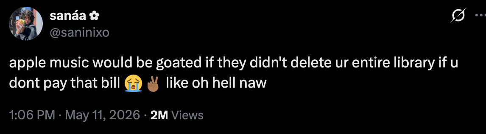

# Rekora

Rekora is an MVP for a simple Apple Music backup tool.

The idea comes from a common fear: people spend years building playlists,
saving albums, and collecting songs, then worry that a missed bill,
subscription change, sync issue, or account problem could make that library
feel gone.

Apple Music is great for listening, but it is not a personal backup system.
Rekora aims to give users their own copy of the important details in
their music library.

## What We Are Building

We are building a local-first app that can:

- Connect to a user's Apple Music account with permission.
- Save snapshots of songs, albums, playlists, and playlist order.
- Let users export their library backup as a file.
- Show what changed between backups.
- Help rebuild playlists later when Apple Music allows it.
- Clearly explain what could not be restored.

The goal is not to pirate music, bypass subscriptions, or copy audio files.
The goal is to preserve the user's library map: what they saved, how playlists
were arranged, and enough track information to rebuild as much as possible.

## MVP Scope

The first version should stay small:

- Apple Music sign-in and permission request.
- Manual library snapshot.
- Local snapshot storage.
- User-controlled backup export.
- Backup import.
- Playlist backup with song order.
- Basic change view between two snapshots.
- Restore preview before making changes.
- Playlist recreation for matched tracks.

Anything more advanced can wait until the basic backup and rebuild flow feels
trustworthy.

## Build Target

Rekora should start as an iPhone app.

The app should be built with SwiftUI and MusicKit because the user's Apple
Music library already lives inside Apple's ecosystem. Starting on iPhone keeps
the first version focused and lets us test the core flow quickly.

A Mac app can come later if desktop library export, power-user tools, or larger
playlist management becomes important.

The website, if we make one, should start as a simple landing page. It should
not be the main product for the MVP.

## First Place To Start

Start with one small proof of concept:

1. Create a blank SwiftUI iPhone app named Rekora.
2. Add MusicKit permission text to the app.
3. Ask the user for Apple Music access.
4. Read a small piece of library data, such as playlists.
5. Save one local JSON snapshot.

If that works, the rest of the MVP becomes much less risky.

## Recommended Tech Stack

- App: SwiftUI
- Apple Music access: MusicKit and Apple Music API
- Local storage: SwiftData or SQLite
- Backup file format: versioned JSON
- Optional sync later: CloudKit private database
- Testing: XCTest
- First distribution path: TestFlight

This stack keeps the project close to the Apple ecosystem, where the user's
music library already lives. It also avoids storing private library data on our
servers during the MVP.

The first backup schema is documented in `BACKUP_SCHEMA.md`. It defines the
portable JSON format Rekora will export and import, even if the app later uses
SwiftData or SQLite for local indexing.

First-time local development setup is documented in `DEVELOPMENT.md`.

Functional completion criteria are tracked in `FUNCTIONAL_MVP.md`. Remaining
MVP gaps are tracked in GitHub issues for large backup/export stress testing,
expected-failure error handling, and the final validation pass. App icon and
visual identity work is tracked separately as polish, not as a functional MVP
blocker.

A local visual brief for this project lives at [docs/index.html](docs/index.html).

The app can currently request Apple Music permission, check Apple Music
subscription and Sync Library readiness, read songs, albums, playlists, and
ordered playlist tracks, save a real backup inside Rekora's private app
storage, show the latest saved backup from a small local `latest-backup.json`
manifest, and let the user save a visible backup copy through the iOS Files
flow with a friendly local-time filename such as
`Rekora Backup - 2026-06-06 at 8-44 PM.json`.
Rekora can also check a selected backup file and show a read-only summary when
the app can read it. New backup exports include a plain
`rekora.backup.snapshot` format marker, while older schema-v1 backups without
the marker remain readable.
The app also shows a restrained wordmark-only startup screen: 1.3 seconds on
first-ever launch, then only a brief continuity cover on later cold launches.
Real-device validation on June 6, 2026 confirmed a 9,453 song, 93 album, 19
playlist export from a physical iPhone. The exported file matched the app's
private snapshot byte-for-byte. Rekora preserves MusicKit-reported playlist
positions and also records observed `snapshotOrder` so future restore work has
a fallback when MusicKit reports invalid all-zero positions. After each backup,
Rekora shows a visible inline warning note when Apple reports unusual playlist
order data and confirms that observed order was saved too. The backup detail
screen can compare the selected backup with the previous local backup and show
a read-only Changes summary. It also shows a read-only Restore preview that
summarizes how many playlists and playlist entries Rekora can prepare, and can
run a read-only Apple Music match check to separate found tracks from tracks
that may need review. After a live match check, Rekora can prepare a
confirmation-gated one-playlist rebuild that creates a new Apple Music
playlist only, preserves confident matched-track order, and skips tracks that
need review. Metadata-only search matches are not automatically rebuilt. It
does not edit, reorder, replace, or delete existing playlists. Real-device
validation on June 19, 2026 rebuilt a disposable 30-track `Rekora Test Source`
playlist into a new `Rekora Restore - Rekora Test Source` playlist. A
baseline/post-restore JSON comparison confirmed all 20 existing playlists were
unchanged.

## Why Native First

A web app could be faster to share, but this problem is about trust and
personal data. A native Apple app gives us a cleaner way to ask for MusicKit
access, store backups locally, and build features that feel like they belong
on the user's device.

## What This Is Not

This is not a replacement for Apple Music.

This is not a way to keep streaming songs without an active subscription.

This is not a promise that every song can always be restored. Tracks can be
removed, renamed, region-locked, replaced, or matched to the wrong version.
The app should be honest about those limits.

## Success For The MVP

The MVP succeeds if a user can say:

"Even if something happens to my Apple Music account, I still have a clear
record of my library and a practical way to rebuild my playlists."
